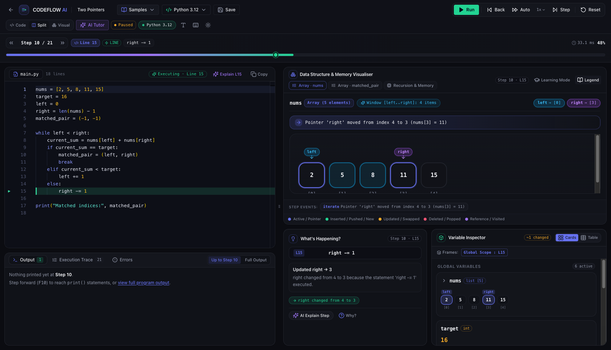
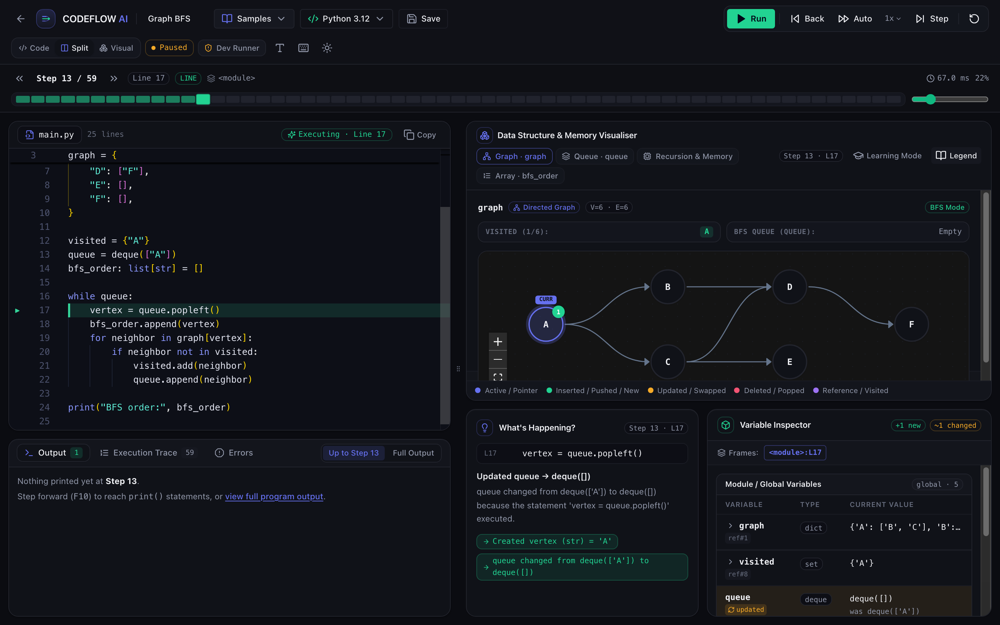
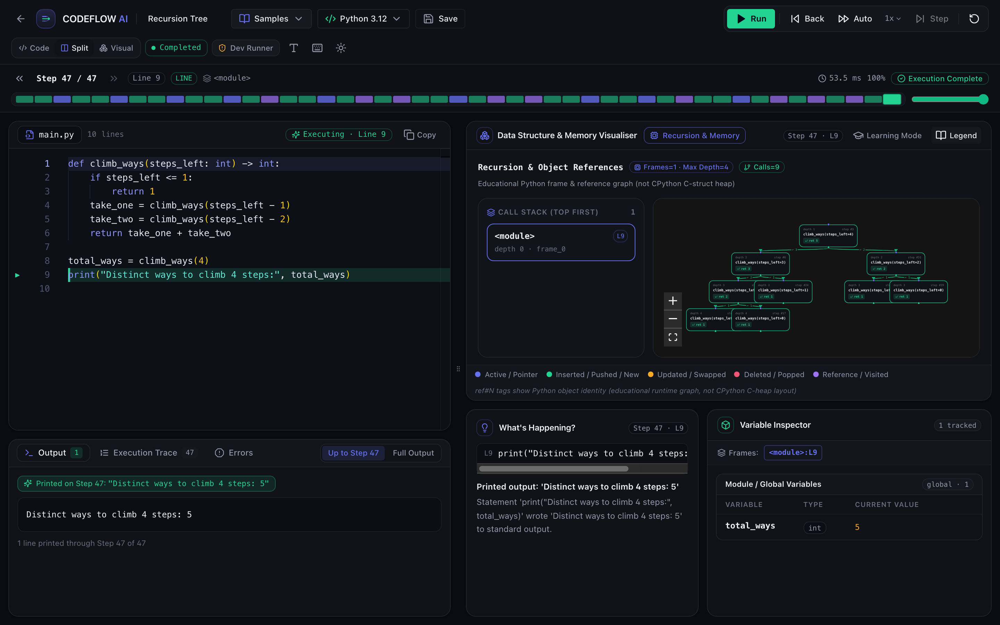
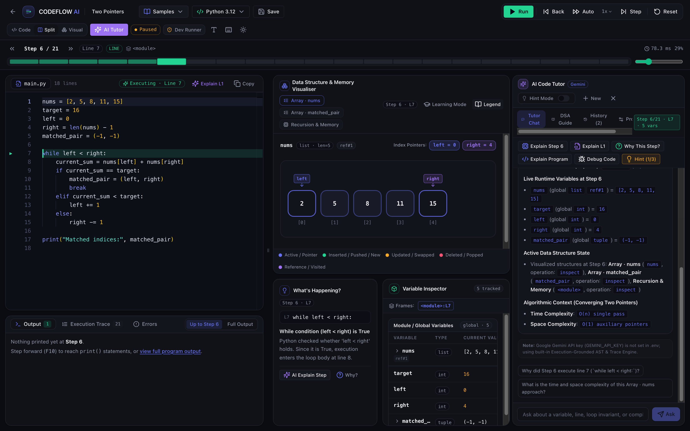
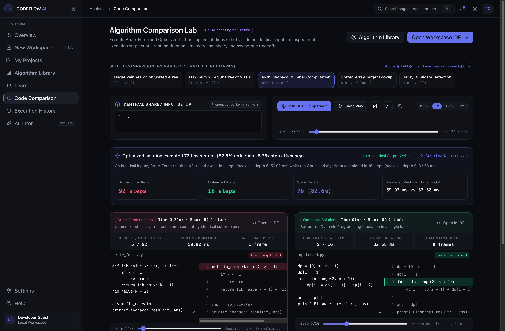
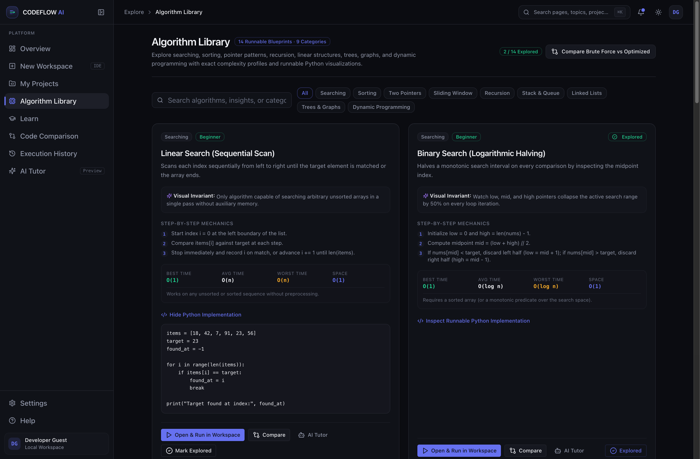
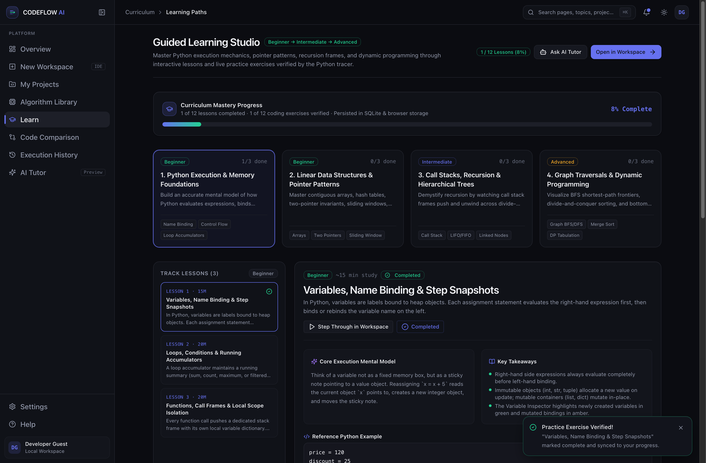
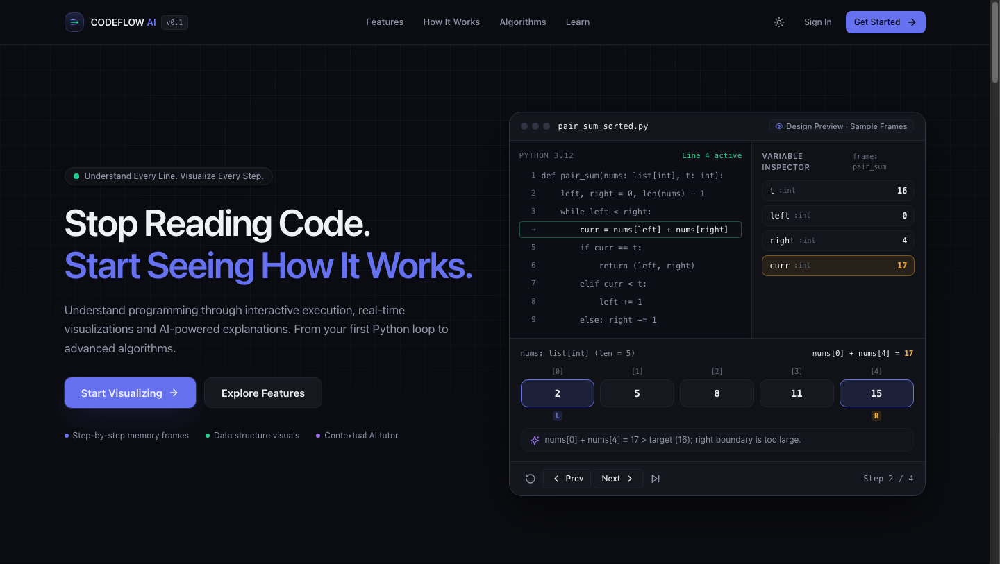

<div align="center">

# 🚀 CodeFlow AI

### **Understand Every Line. Visualize Every Step.**

**CodeFlow AI** is a full-stack interactive Python programming visualization and AI learning platform.  
Write code, run it step-by-step, watch data structures come alive, and get real-time AI explanations — all in one place.

[](https://nextjs.org/)
[](https://www.typescriptlang.org/)
[](https://fastapi.tiangolo.com/)
[](https://www.python.org/)
[](https://tailwindcss.com/)

</div>

---

## 🤔 Why Does This Exist?

Most people learn Python by reading code — but **reading code is not the same as understanding execution**.

> _You read_ `for i in range(len(nums))` _ten times. You still can't picture what_ `nums[i]` _is at step 7._

Traditional debuggers show you values in a table. That's still just text. What if the array actually moved? What if `left` and `right` pointers visually tracked across cells? What if a recursion tree drew itself in real-time as Python called each frame?

**CodeFlow AI was built to answer these questions visually.**

---

## ✨ What It Does — Feature by Feature

### 1. 🖥️ Interactive Python Code Workspace

Write or paste any Python program in a Monaco editor (the same editor that powers VS Code). Hit **Run**, and the platform:

- Captures every single execution step using Python's built-in `sys.settrace` tracer
- Lets you **step forward and backward** through execution like a time machine
- Shows you **exactly which line is executing**, highlighted in real-time
- Tells you in plain English **what each step does**, with beginner-friendly explanations

**You can pause, rewind, replay. You are in complete control of time.**



> 📌 _In the screenshot above: The program is paused at Step 10 / 21. You can see `right -= 1` executing on Line 15. The fluid scrubber at the top shows progress. The array visualizer on the right shows the `left` and `right` pointer positions live. The Variable Inspector on the right shows all 6 active variables as animated cards._

---

### 2. 🧠 Live Data Structure Visualizer

This is the heart of CodeFlow AI. The platform **automatically detects** data structures in your Python program and renders them visually — no special annotations required.

**Supported Structures:**

| Structure               | What You See                                                                                     |
| ----------------------- | ------------------------------------------------------------------------------------------------ |
| **Arrays / Lists**      | Animated cells with index labels, pointer arrows (`left`, `right`, `i`), sliding window brackets |
| **Two Pointers**        | Named pointer pills floating above cells, converging in real-time                                |
| **Stacks & Queues**     | LIFO push/pop and FIFO enqueue/dequeue animations                                                |
| **Linked Lists**        | Nodes with arrows, `next` pointer traversal, cycle detection                                     |
| **Binary Trees / BSTs** | Hierarchical tree layout with current-node highlighting                                          |
| **Heaps**               | Min/Max heap tree with sift-up/sift-down animations                                              |
| **Hash Maps / Dicts**   | Key→Value pair visualization with collision awareness                                            |
| **Graphs (BFS/DFS)**    | Interactive node-edge graph with visited/queue state                                             |
| **Recursion Trees**     | Full call tree drawn as Python recurses — with return values                                     |



> 📌 _Above: Graph BFS in action. The visualizer shows the directed graph with node A currently being processed (highlighted). The visited set and BFS queue are both shown live. The `What's Happening?` panel explains every mutation in plain English._

<br/>



> 📌 _Above: A `climb_ways(4)` recursion problem. The full call tree drew itself step-by-step as Python recursed 9 times. Each frame is a node. Return values propagate upward. The call stack panel shows depth = 4._

---

### 3. 🤖 Execution-Aware AI Tutor

The AI Tutor is **not a generic chatbot**. It is grounded in your actual runtime — it knows:

- The exact line being executed right now
- Every variable's current and previous value
- The active call stack frames
- What data structures are on screen
- Any runtime errors that occurred

You can ask it things like:

- _"Why did Step 6 execute line 7?"_
- _"Explain this Two Pointers approach"_
- _"I got an IndexError — what did I do wrong?"_
- _"What's the time complexity of this loop?"_

It answers based on **your actual code and actual values** — never fabricated.



> 📌 _Above: The AI Tutor panel (right column) shows Live Runtime Variables at Step 6, the Active Data Structure State, and the Algorithmic Context with time and space complexity. The tutor answered "Why This Step?" using the real trace — not a hallucination._

**AI Providers supported:**

- **Google Gemini** (via `GEMINI_API_KEY`)
- **OpenAI GPT** (via `OPENAI_API_KEY`)
- **Built-in Execution-Trace Engine** — works fully offline, zero API key needed. Uses AST analysis + trace data to give real explanations.

---

### 4. ⚡ Algorithm Comparison Lab

Ever wondered **why O(n log n) beats O(n²)** in practice — not just in theory?

The Comparison Lab runs **two Python implementations side-by-side** on identical inputs and shows:

- Exact execution step counts (Brute-Force: 92 steps vs Optimized: 16 steps)
- Real measured runtime in milliseconds
- Call stack depth comparison
- Variable memory snapshots at each step
- Synchronized playback scrubber



> 📌 _Above: Fibonacci Brute-Force (O(2ⁿ) naive recursion) vs Bottom-Up DP (O(n)). On input n=6, brute-force took 92 steps and 59.92ms. The optimized DP took just 16 steps and 32.58ms — an 82.6% reduction. Both produce identical output, verified live._

---

### 5. 📚 Algorithm Library

A searchable, categorized collection of **14 runnable algorithm blueprints** across 9 categories.

Each algorithm includes:

- Plain-English explanation + visual invariant
- Step-by-step mechanics
- Best/Average/Worst time complexity + space complexity
- Full working Python implementation
- One-click **Open & Run in Workspace** button



**Categories covered:** Searching · Sorting · Two Pointers · Sliding Window · Recursion · Stack & Queue · Linked Lists · Trees & Graphs · Dynamic Programming

---

### 6. 🎓 Guided Learning Studio

A structured curriculum from beginner to advanced — with real Python exercises that are **verified by the execution engine** when you submit them.



**Learning Paths:**

| Level            | Topics                                                                  |
| ---------------- | ----------------------------------------------------------------------- |
| **Beginner**     | Variables & Name Binding, Loops & Accumulators, Functions & Scope       |
| **Intermediate** | Arrays, Two Pointers, Sliding Window, Hash Maps, Call Stack & Recursion |
| **Advanced**     | Trees, Graph Traversals, Dynamic Programming, Merge Sort, Quick Sort    |

Progress is **persisted** in SQLite + browser storage — your completed lessons survive page refreshes and server restarts.

---

### 7. 🎨 Architectural Landing Page & Dashboard

A design system built for focus. Dark mode by default, high-contrast visual tokens, and an interactive sample runner right in the hero banner:



> 📌 _Above: The CodeFlow AI landing page featuring the live sample preview with step-by-step memory frames, interactive pointer scrubbers, and variable inspector preview._

---

## 🏗️ How It Works — Architecture

```
┌────────────────────────────────────────────────────────────┐
│                    Browser (Next.js 15)                    │
│                                                            │
│  Monaco Editor  →  Zustand Store  →  Visualizer Engine    │
│  (write code)       (state mgmt)    (renders structures)  │
│                           ↓                               │
│               API Client (fetch)                          │
└──────────────────────────┬─────────────────────────────────┘
                           │ POST /api/execute
                           ▼
┌────────────────────────────────────────────────────────────┐
│               Python 3.12 FastAPI Backend                  │
│                                                            │
│  runner.py → spawns isolated subprocess                    │
│  worker_entry.py → PEP 578 audit hooks + env scrubbing    │
│  tracer.py → sys.settrace captures every frame            │
│  serializer.py → converts Python objects → JSON           │
│  explainer.py → generates step explanations               │
│                                                            │
│  Returns: { steps[], variables[], structures[], error }   │
└────────────────────────────────────────────────────────────┘
```

**The key design decision:** User Python code **never runs in the Next.js process or the FastAPI server process**. It always runs in an isolated subprocess with PEP 578 audit hooks that block network, file system, subprocess spawning, and dynamic imports.

---

## 🛡️ Security Model

CodeFlow AI enforces defense-in-depth controls:

| Control                | Implementation                                                                 |
| ---------------------- | ------------------------------------------------------------------------------ |
| **Process Isolation**  | User code runs in a separate subprocess, never in-process                      |
| **Secret Scrubbing**   | `os.environ.clear()` before user code compiles                                 |
| **PEP 578 Audit Hook** | Blocks `open()`, `socket.*`, `subprocess.*`, `os.fork`, `ctypes`, `dlopen`     |
| **Module Allowlist**   | Only safe stdlib modules: `math`, `collections`, `heapq`, etc.                 |
| **Resource Caps**      | Max 500 steps, 60 recursion depth, 24KB stdout, POSIX RLIMIT caps              |
| **Timeout Kill**       | SIGKILL sent to entire process group on timeout                                |
| **Production Guard**   | `CODEFLOW_ENV=production` requires Docker sandbox, refuses subprocess fallback |

---

## ⚙️ Tech Stack

**Frontend**

- [Next.js 15](https://nextjs.org/) with App Router + TypeScript
- [Tailwind CSS](https://tailwindcss.com/) + [shadcn/ui](https://ui.shadcn.com/)
- [Monaco Editor](https://microsoft.github.io/monaco-editor/) (VS Code's editor)
- [Framer Motion](https://www.framer.com/motion/) for all animations
- [Zustand](https://zustand-demo.pmnd.rs/) for state management
- [Lucide React](https://lucide.dev/) icons

**Backend**

- [Python 3.12](https://www.python.org/) with `sys.settrace` tracer
- [FastAPI](https://fastapi.tiangolo.com/) + [Uvicorn](https://www.uvicorn.org/)
- [SQLite](https://www.sqlite.org/) for persistence
- Google Gemini / OpenAI for AI Tutor (optional)

---

## 🚀 Getting Started

### Prerequisites

- **Node.js** `>= 20.x` and `npm`
- **Python 3.12**
- _(Optional, for production isolation)_ Docker Desktop

### 1. Clone the repository

```bash
git clone https://github.com/ktirumalaachari/CodeFlow-AI.git
cd CodeFlow-AI
```

### 2. Configure environment variables

```bash
cp .env.example .env.local
cp .env.example backend/.env
```

Optionally add your AI API key to `backend/.env`:

```env
# Pick one (or neither — the built-in tracer engine works without any key)
GEMINI_API_KEY=your_gemini_key_here
OPENAI_API_KEY=your_openai_key_here
```

### 3. Start the Python backend

```bash
cd backend
python3.12 -m venv .venv
.venv/bin/pip install -r requirements.txt
.venv/bin/uvicorn app.main:app --host 127.0.0.1 --port 8000 --reload
```

### 4. Start the Next.js frontend

```bash
# In a new terminal, from the project root:
npm install
npm run dev
```

Open **http://localhost:3000** — you're ready to visualize code! 🎉

---

## 🧪 Running Tests

```bash
# Backend: 73 pytest tests (tracer, security, tutor, persistence, comparison)
backend/.venv/bin/pytest backend/tests -v

# Frontend: 18 unit tests (visualizer engine, AI tutor grounding, algorithm catalog)
npm test

# Type checking + lint + production build
npm run typecheck
npm run lint
npm run build
```

All tests pass: **73/73 backend** · **18/18 frontend** · **0 TypeScript errors** · **0 lint warnings**

---

## 🗺️ Pages & Routes

| Route         | Description                                  |
| ------------- | -------------------------------------------- |
| `/`           | Marketing landing page                       |
| `/dashboard`  | Overview, metrics, quick-start               |
| `/workspace`  | **Main Python IDE + Visualizer + AI Tutor**  |
| `/algorithms` | Searchable algorithm library (14 blueprints) |
| `/comparison` | Brute-force vs optimized side-by-side lab    |
| `/learn`      | Guided learning paths (12 lessons)           |
| `/tutor`      | Standalone AI Tutor Studio                   |
| `/projects`   | Saved projects manager                       |
| `/history`    | Replayable execution history                 |
| `/settings`   | Theme, profile, security audit               |

---

## 🎯 Who Is This For?

| Audience               | How They Use It                                                                                 |
| ---------------------- | ----------------------------------------------------------------------------------------------- |
| **Absolute beginners** | Watch variables appear as assignments execute. Read plain-English step explanations. No jargon. |
| **DSA students**       | Visualize Two Pointers converging, BFS frontiers expanding, recursion trees growing             |
| **Interview prep**     | Use the Comparison Lab to truly understand why optimized solutions are better                   |
| **Curious developers** | Paste unfamiliar code and ask the AI Tutor to explain every step                                |

---

## 📄 License

MIT © 2026 CodeFlow AI

---

<div align="center">
  
## 👨‍💻 Author

**K Tirumala Achari**  
Full Stack Developer | Aspiring Software Engineer

<a href="mailto:ktirumalachari@gmail.com">
  
</a>
<a href="https://www.linkedin.com/in/k-tirumala-achari-921106307/">
  
</a>
<a href="https://github.com/ktirumalaachari">
  
</a>
<a href="https://www.ktirumalaachari.me">
  
</a>
<br/><br/>

> _"Passionate about building impactful, user-centric solutions through technology,_
> _committed to continuous learning and innovation."_

**⭐ If you found this project helpful or inspiring, please give it a star! ⭐**

Made with ❤️ by **K Tirumala Achari**

[](https://github.com/ktirumalaachari)

**Built with ❤️ to make programming visual, intuitive, and actually fun to learn.**

</div>
